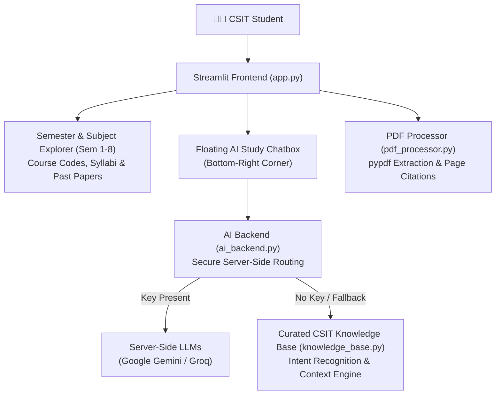

# 🎓 TU BSc CSIT Study Assistant & Learning Platform

A comprehensive, student-friendly learning platform for **Tribhuvan University (TU) BSc CSIT students**, inspired by the information architecture, curriculum hierarchy, and usefulness of [HamroCSIT](https://hamrocsit.com/).

Developed by **[Samyog Sapkota](https://github.com/hola-mundo999)** · *BSc CSIT, Prime College · PR Director, Prime IT Club*.

---

## 🌟 Key Features

1. **📚 Semester & Course Curriculum (Semesters 1 to 8):**
   - Full TU course breakdown across all 8 semesters with official course codes (`CSC206`, `CSC260`, etc.), credit hours, and syllabi.
2. **📖 Curated High-Yield Study Guides:**
   - Academic explanations with definitions, step-by-step algorithms, worked numerical examples, pseudocode, Python/C++ implementations, time/space complexity proofs, and TU exam preparation points.
3. **💬 Persistent Floating AI Study Tutor:**
   - Accessible from the bottom-right corner across all views.
   - Provides instant academic explanations, simple language (ELI5) analogies, mathematical worst-case derivations, side-by-side concept comparisons, and model TU exam practice questions.
   - Preserves conversational context across follow-up queries.
4. **🔒 Secure Server-Side AI Architecture:**
   - Zero API key configuration exposed to students.
   - Automatically utilizes server-side AI providers (Google Gemini or Groq) when configured by administrators via environment variables.
   - Features a rich, deterministic offline knowledge engine that answers CSIT queries out-of-the-box without requiring any API keys.
5. **📝 TU Board Exam Question Bank & Prep Generator:**
   - Authentic past board exam questions from TU examinations.
   - One-click practice exam generator with model answers, rubrics, and downloadable study sheets (`.txt`).
6. **📄 Lecture Document Parsing & Chunking:**
   - Upload semester lecture PDFs or notes to extract text, inspect page statistics, and receive context-grounded answers with page citations.

---

## 🏗️ System Architecture



---

## 🛠️ Tech Stack

- **Language:** Python 3.10+
- **Frontend / Framework:** [Streamlit](https://streamlit.io/)
- **Document Processing:** [pypdf](https://pypi.org/project/pypdf/)
- **AI Integrations:** Google GenAI SDK (`google-genai`), Groq SDK (`groq`)
- **Testing:** [pytest](https://pytest.org/)

---

## 🚀 Getting Started

### 1. Clone the repository
```bash
git clone https://github.com/hola-mundo999/ai-csit-study-assistant.git
cd ai-csit-study-assistant
```

### 2. Create and activate a Virtual Environment
```bash
# Windows
python -m venv venv
venv\Scripts\activate

# macOS / Linux
python3 -m venv venv
source venv/bin/activate
```

### 3. Install dependencies
```bash
pip install -r requirements.txt
```

### 4. Run the application
```bash
streamlit run app.py
```

The application will launch at `http://localhost:8501`.

---

## ⚙️ Server-Side AI Configuration (Optional)

The application works completely **offline out-of-the-box** using its built-in CSIT knowledge engine. Students never need to provide personal API keys.

To enable live LLM generation on the server or deployment host:

```bash
# Linux / macOS
export GEMINI_API_KEY="your-gemini-key"
# or
export GROQ_API_KEY="your-groq-key"

# Windows PowerShell
$env:GEMINI_API_KEY="your-gemini-key"
# or
$env:GROQ_API_KEY="your-groq-key"
```

---

## 🧪 Testing

Run the automated test suite covering PDF processing, offline fallback, QuickSort regression, intent recognition, and conversational context retention:

```bash
pytest
```

---

## 📬 Contact & Connect

- **Author:** Samyog Sapkota
- **GitHub:** [@hola-mundo999](https://github.com/hola-mundo999)
- **LinkedIn:** [linkedin.com/in/samyogsapkota](https://www.linkedin.com/in/samyogsapkota/)
- **College:** Prime College, Khusibu, Kathmandu
- **Live Demo:** [https://ai-csit-study-assistant.streamlit.app](https://ai-csit-study-assistant.streamlit.app)
