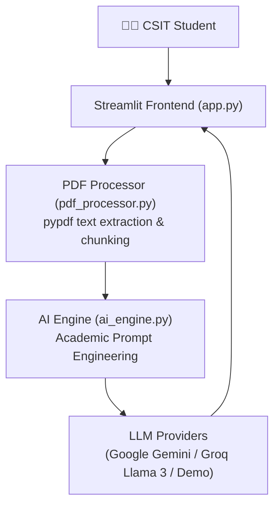

# 🎓 AI CSIT Study & Lecture Notes Assistant

An intelligent study companion engineered for **BSc CSIT students** (Tribhuvan University) to analyze lecture notes, summarize syllabi, generate practice exam question papers, and query course concepts using modern Large Language Models (LLMs).

Developed by **[Samyog Sapkota](https://github.com/hola-mundo999)** · *BSc CSIT, Prime College · PR Director, Prime IT Club*.

---

## 🌟 Key Features

1. **📄 PDF Lecture Parsing & Chunking:**
   - Extracts and structures text from semester lecture PDFs, syllabus documents, and past board question papers.
2. **💬 Context-Grounded Q&A Chat:**
   - Answers student queries based strictly on the provided lecture context to avoid hallucinations.
   - Generates code snippets in **C**, **C++**, and **Python** with complexity analysis.
3. **📝 TU-Style Exam Paper Generator:**
   - Automatically generates 5+ practice exam questions with complete **Model Answers**, marking rubrics, and step-by-step solutions.
   - Includes one-click download of the exam paper as a `.txt` study sheet.
4. **⚡ Rapid Revision & Flashcard Engine:**
   - Summarizes high-yield definitions, mathematical formulas, and algorithmic time/space complexities ($\mathcal{O}(n)$).
5. **🔌 Multi-Model AI Routing:**
   - Seamlessly switch between **Google Gemini (2.5 Flash)**, **Groq (Llama-3.3-70B)**, or an instant offline **Demo Mode**.

---

## 🏗️ System Architecture



---

## 🛠️ Tech Stack

- **Language:** Python 3.10+
- **Frontend / Framework:** [Streamlit](https://streamlit.io/)
- **Document Processing:** [pypdf](https://pypi.org/project/pypdf/)
- **AI Integrations:** Google GenAI SDK (`google-genai`), Groq SDK (`groq`)
- **Version Control:** Git & GitHub

---

## 🚀 Getting Started

### 1. Clone the repository
```bash
git clone https://github.com/hola-mundo999/ai-csit-study-assistant.git
cd ai-csit-study-assistant
```

### 2. Create and activate a Virtual Environment
```bash
# Windows
python -m venv venv
venv\Scripts\activate

# macOS / Linux
python3 -m venv venv
source venv/bin/activate
```

### 3. Install dependencies
```bash
pip install -r requirements.txt
```

### 4. Run the application
```bash
streamlit run app.py
```

The application will launch in your browser at `http://localhost:8501`.

---

## 🔑 API Keys (Optional)
The application includes a built-in **Demo Mode** out of the box! To enable live generation:
- Get a free Gemini key at: [Google AI Studio](https://aistudio.google.com/)
- Get a free Groq key at: [Groq Console](https://console.groq.com/)
- Paste the key directly in the sidebar settings.

---

## 📬 Contact & Connect

- **Author:** Samyog Sapkota
- **GitHub:** [@hola-mundo999](https://github.com/hola-mundo999)
- **LinkedIn:** [linkedin.com/in/samyogsapkota](https://www.linkedin.com/in/samyogsapkota/)
- **College:** Prime College, Khusibu, Kathmandu
