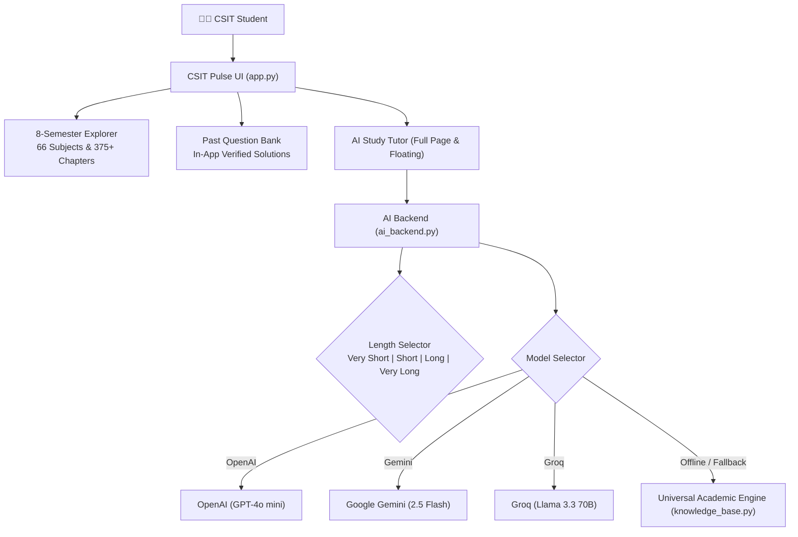

# ⚡ TU CSIT PULSE — Smart Academic Learning Platform & Multi-Model AI Tutor

A comprehensive, student-friendly learning platform for **Tribhuvan University (TU) BSc CSIT students**, featuring verified semester notes, solved past board exam questions, official TU IOST syllabi, and an intelligent **Multi-Model AI Study Tutor** with customizable answer lengths.

Developed by **[Samyog Sapkota](https://github.com/hola-mundo999)** · *BSc CSIT, Prime College · PR Director, Prime IT Club*.

---

## 🌟 Key Features

1. **📚 Complete 8-Semester Curriculum:**
   - Full TU course breakdown across all 8 semesters with official course codes (`CSC206`, `CSC260`, `CSC259`, etc.), credit hours, syllabi, and 375+ chapter modules.
2. **🤖 Multi-Model AI Academic Tutor:**
   - Powered by **OpenAI ChatGPT** (`gpt-4o-mini`), **Google Gemini** (`gemini-2.5-flash`), **Groq** (`llama-3.3-70b-versatile`), and an intelligent **Local Universal Engine**.
   - Answers **ANY** computer science or IT question across all subjects (DSA, OS, DBMS, Networks, OOP, Automata, AI, Microprocessors).
3. **⚡ 4 Customizable Answer Length Modes:**
   - ⚡ **Very Short** (`< 70 words`): Direct definition, essential time/space complexity, and primary takeaway.
   - 📄 **Short** (`~150 words`): Focused 1–2 paragraph explanation with core mechanism and formula.
   - 📖 **Long** (`~400 words`): Standard university exam response with step-by-step mechanism, code snippet, and complexity.
   - 📚 **Very Long** (`~850+ words`): Master TU Academic Guide with theoretical foundations, mathematical derivations/proofs, runnable code/pseudocode, TU board exam marking rubrics, and 3 practice exam questions with model answers.
4. **💡 In-App Verified Past Question Solutions (No Paywalls):**
   - Verified step-by-step solutions for past TU board examination questions rendered directly in-app.
   - Zero external redirects or premium subscription paywalls.
   - Interactive "Ask AI Tutor to Explain" button on every question.
5. **🔒 Robust Multi-Tier Answering Architecture:**
   - Grounded in local verified curriculum notes first.
   - External multi-model fallback when keys are provided.
   - Works 100% offline out-of-the-box using the built-in universal CSIT engine.

---

## 🏗️ System Architecture



---

## 🛠️ Tech Stack

- **Language:** Python 3.10+
- **Frontend / Framework:** [Streamlit](https://streamlit.io/)
- **Document Processing:** [pypdf](https://pypi.org/project/pypdf/)
- **AI Integrations:** OpenAI SDK (`openai`), Google GenAI SDK (`google-genai`), Groq SDK (`groq`)
- **Testing:** [pytest](https://pytest.org/)

---

## 🚀 Getting Started (Local Run)

### 1. Clone the repository
```bash
git clone https://github.com/hola-mundo999/ai-csit-study-assistant.git
cd ai-csit-study-assistant
```

### 2. Create and activate a Virtual Environment
```bash
# Windows PowerShell
python -m venv venv
.\venv\Scripts\activate

# macOS / Linux
python3 -m venv venv
source venv/bin/activate
```

### 3. Install dependencies
```bash
pip install -r requirements.txt
```

### 4. Run the application
```bash
streamlit run app.py
```

The application launches at `http://localhost:8501`.

---

## 🌐 Deployment

### A. Streamlit Community Cloud (Recommended)
1. Fork or push this repository to GitHub: `https://github.com/<your-username>/ai-csit-study-assistant`.
2. Visit [share.streamlit.io](https://share.streamlit.io/) and click **New app**.
3. Select your repository, branch `main`, and main file `app.py`.
4. (Optional) In **Advanced settings > Secrets**, configure server-side API keys:
   ```toml
   OPENAI_API_KEY = "your-openai-key"
   GEMINI_API_KEY = "your-gemini-key"
   GROQ_API_KEY = "your-groq-key"
   ```
5. Click **Deploy**. Your app will be live with full WebSocket and interactive state support!

### B. Live Demo
- **Streamlit Cloud App:** [ai-csit-study-assistant.streamlit.app](https://ai-csit-study-assistant.streamlit.app)
- **Local Host:** `http://localhost:8501`

---

## 🧪 Automated Testing

Run the full verification test suite:

```bash
pytest
python verify_app.py
```

---

## 👨‍💻 Developer & Attribution

- **Developer:** **Samyog Sapkota**
- **Institution:** Prime College, Khusibu, Kathmandu
- **Program:** B.Sc. Computer Science and Information Technology (TU BSc CSIT)
- **GitHub:** [@hola-mundo999](https://github.com/hola-mundo999)
- **LinkedIn:** [linkedin.com/in/samyogsapkota](https://www.linkedin.com/in/samyogsapkota/)
